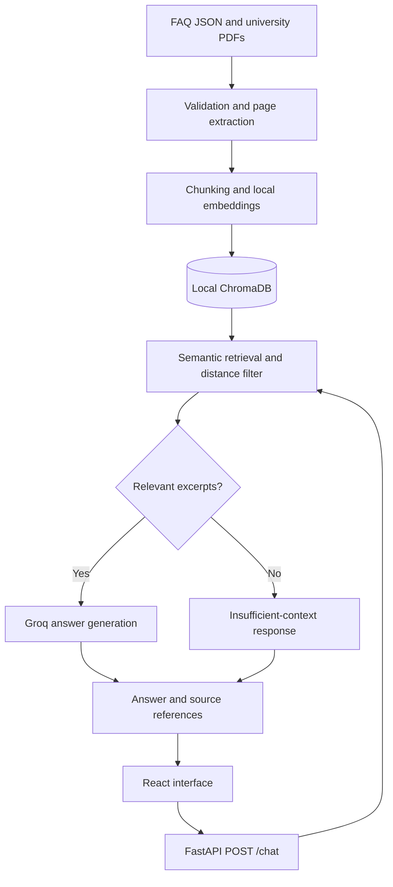

# University FAQ Chatbot

A university information assistant built with **React, FastAPI, ChromaDB and Groq**.
It retrieves relevant passages from a local FAQ and university PDFs before generating
a French answer with source references.

**Portfolio maintainer: Imane Agga**, Data & Software Engineering student at INSEA, Rabat.
Original project contributions are preserved in the Git history.
This academic portfolio project demonstrates API design, document ingestion,
vector search, LLM integration, automated testing and practical data protection.

> Demonstration project, independent of Sorbonne Université. The bundled corpus
> contains documents from 2019–2026. Answers are not official university advice;
> check the original document and its academic year before relying on a date or fee.

## Features

- Semantic retrieval from a **real, persistent ChromaDB collection** shared by FAQ and PDF ingestion.
- Local ONNX embeddings (`all-MiniLM-L6-v2`), cosine distance filtering and configurable top-k retrieval.
- PDF chunking with overlap, filename/page metadata, deterministic IDs and repeatable upserts.
- Grounded answer prompt, numbered source references and an explicit insufficient-context response.
- Groq SDK integration with configurable model, bounded timeout/retries and sanitized API errors.
- React chat interface with browser-local conversations, source details and server error handling.
- Input validation, explicit CORS origins, environment templates and offline regression tests.

## How it works

Ingestion extracts PDF text page by page, splits it into 800-character chunks
with 120-character overlap, embeds the chunks, and stores them alongside FAQ entries
in the `university_knowledge` collection. Search uses the **same embedding function
and database path**. Only selected excerpts and the current question are sent to Groq.



The API is stateless: it does not retain questions or expose a shared chat history.
Each request is independent; follow-up pronouns such as “et pour cette année ?”
are not resolved from previous messages.

## Quick start

Prerequisites: **Python 3.12**, **Node.js 24 LTS**, npm, a Groq API key and an internet
connection for dependency installation, the first embedding-model download (~80 MB)
and Groq requests. Embeddings run locally after that download.

From the repository root (macOS/Linux):

```bash
git clone https://github.com/imane000/university-faq-chatbot.git
cd university-faq-chatbot
python3.12 -m venv .venv
source .venv/bin/activate
python -m pip install --upgrade pip
python -m pip install -r backend/requirements-dev.txt
cp backend/.env.example backend/.env
cp frontend/.env.example frontend/.env
```

Windows PowerShell equivalents for the environment setup:

```powershell
py -3.12 -m venv .venv
.\.venv\Scripts\Activate.ps1
python -m pip install --upgrade pip
python -m pip install -r backend/requirements-dev.txt
Copy-Item backend/.env.example backend/.env
Copy-Item frontend/.env.example frontend/.env
```

Set `GROQ_API_KEY` in **`backend/.env` only**. The default model is
`openai/gpt-oss-20b`; change `GROQ_MODEL` if your Groq account uses another available
chat model. No OpenAI API key is needed. See [Groq's model lifecycle](https://console.groq.com/docs/deprecations).

Index the bundled sources and start the API:

```bash
cd backend
python -m app.rag.ingest_faq
python -m app.rag.ingest_pdf
uvicorn app.main:app --reload --host 127.0.0.1 --port 8000
```

In a second terminal, from the repository root:

```bash
cd frontend
npm ci
npm run dev -- --host 127.0.0.1
```

Open **http://127.0.0.1:5173**. Interactive API documentation:
**http://127.0.0.1:8000/docs**.

Try: “Comment se fait l'inscription universitaire ?”, “Comment consulter les notes ?”
or “Que faire en cas d'absence à un examen ?”. Expand **Extraits fournis au modèle**
to inspect the filenames and page numbers supplied to Groq. These are retrieved
references, not a guarantee that every claim in the generated answer is supported.

## Configuration

All backend variables are documented in [backend/.env.example](backend/.env.example).
Environment variables take precedence over that file. Paths resolve from `backend/`,
regardless of the command's working directory.

| Variable | Default | Purpose |
| --- | --- | --- |
| `GROQ_API_KEY` | Empty | Backend-only provider credential |
| `GROQ_MODEL` | `openai/gpt-oss-20b` | Groq chat model |
| `GROQ_TIMEOUT_SECONDS` | `30` | Per-attempt provider timeout, one retry maximum |
| `GROQ_MAX_TOKENS` | `1024` | Completion token budget, including model reasoning |
| `CHROMA_PATH` | `backend/chroma_db` | Local generated index |
| `CHROMA_COLLECTION` | `university_knowledge` | Shared FAQ/PDF collection |
| `DATA_PATH` | `backend/data` | Input documents |
| `RAG_TOP_K` | `4` | Maximum retrieved excerpts |
| `RAG_MAX_DISTANCE` | `0.5` | Maximum cosine distance; lower is stricter |
| `RAG_CONTEXT_CHARS` | `8000` | Maximum excerpt text sent per request |
| `CORS_ORIGINS` | Localhost/127.0.0.1 on port 5173 | JSON array of allowed frontend origins |
| `VITE_API_URL` | `http://127.0.0.1:8000` | Public frontend setting in `frontend/.env` |

Changing `VITE_API_URL` requires restarting Vite or rebuilding the frontend.
Never put credentials in `VITE_` variables: they are included in the public bundle.

### Index updates and migration

Re-run ingestion after editing a source. Unchanged chunks are upserted without
duplicates; obsolete chunks belonging to that source are removed after successful
upserts. Run ingestion as a **single offline writer** with the API stopped.
A failed multi-batch update is not transactional; rerun ingestion before restarting.

The old `university_faq`/`university_documents` indexes are not reused. Rebuild into
the new collection using the commands above. Do not commit generated databases.
If a source file is removed, or the embedding/chunking strategy changes, select a
new `CHROMA_COLLECTION` value and re-ingest the full desired corpus. This avoids
serving stale passages. Old local collections can then be deleted manually.

## API

| Endpoint | Behavior |
| --- | --- |
| `GET /` | Project information |
| `GET /health` | Liveness check; does not verify the index, model download or Groq |
| `POST /chat` | Validated question → answer and retrieved source references |
| `GET /docs` | OpenAPI documentation |

```bash
curl -X POST http://127.0.0.1:8000/chat \
  -H 'Content-Type: application/json' \
  -d '{"question":"Comment consulter les notes ?"}'
```

The response has `response: string` and `sources: [{reference, source, page}]`.
`page` is null for FAQ entries. Empty or insufficiently relevant indexes return an
insufficient-context answer without calling Groq. Questions must contain 1–2000
characters after trimming. Errors use FastAPI's `detail` field: 422 for invalid
input, 429 for provider rate limits, 503 for missing configuration/unavailable
services, 504 for provider timeouts, and 502 for failed or empty provider responses.

## Tests and checks

From the repository root, with the Python environment activated:

```bash
pytest -q
ruff check backend scripts
ruff format --check backend scripts
python -m pip check
python scripts/check_repository.py --history
```

```bash
cd frontend
npm run lint
npm test
npm run build
npm audit
```

Backend tests use a **real temporary persistent Chroma database**, deterministic
test-only embeddings, a synthetic PDF and HTTP-mocked responses through the
**official Groq SDK**. They cover retrieval, metadata, persistence, repeated and
updated ingestion, validation, no-context behavior, CORS and provider failures.
They need neither a provider key nor model downloads. They do not measure semantic
accuracy or live provider availability. See [validation results](docs/VALIDATION.md).

GitHub Actions runs these checks on pull requests. Python vulnerability auditing
has four explicitly documented Chroma server-advisory exceptions; it does not
report a fully clean dependency tree. See [security review](docs/SECURITY.md).

## Project structure

```text
backend/
  app/config.py            # Validated environment settings
  app/main.py              # FastAPI routes and request/response schemas
  app/rag/store.py         # Shared persistent Chroma client and source upserts
  app/rag/ingest_faq.py    # FAQ validation and ingestion command
  app/rag/ingest_pdf.py    # PDF page extraction and chunking command
  app/rag/retriever.py     # Semantic search and context formatting
  app/services/llm_service.py  # Groq generation and service errors
  data/                   # Demonstration FAQ and university documents
  tests/                  # Offline integration and regression tests
frontend/src/             # React chat UI and API client
scripts/                  # Repository hygiene checks
```

## Data, privacy and limits

- Bundled university documents retain their original ownership. See the
  [corpus inventory](backend/data/README.md); no affiliation is implied.
- Chat messages are stored in this browser's localStorage. Deleting a conversation
  removes it from that browser. Avoid entering personal or confidential information.
- Groq receives the current question and retrieved excerpts. Review its data policies
  before using a private corpus. No conversation transcript is sent automatically.
- Chroma runs embedded locally. The API has no authentication or rate limiting and
  is intended for local demos. CORS is not access control. Public deployment requires
  authentication, quotas, HTTPS, reviewed data and a fresh security assessment.
- The compact default embedding model is primarily English-oriented; French retrieval
  quality and the distance threshold need a labelled evaluation. No accuracy score
  is claimed. A multilingual model, reranking and retrieval evaluation are next steps.
- Scanned PDFs need OCR. Tables and layouts may be extracted imperfectly. The corpus
  contains dated or potentially conflicting guidance; generation can still be wrong.

## Portfolio focus

This project demonstrates an end-to-end document retrieval and generation flow,
with explicit boundaries between configuration, ingestion, search and generation.
For a PFE technical discussion, useful topics include embedding consistency,
index lifecycle, source attribution, retrieval evaluation, error handling and
the tradeoffs of a local demonstration versus a production service.
